# Startup Intelligence AI

## Indian Startup Funding Analytics, Machine Learning & Explainable AI

**Project type:** Data Analytics + Machine Learning + AI  
**Dataset:** Indian startup funding events, January 2015 – January 2020  
**Dataset size:** 3,044 funding events  
**Status:** Implemented

---

## Project Overview

Startup Intelligence AI is an end-to-end analytics and machine-learning application that combines data cleaning, SQL analysis, exploratory data analysis (EDA), predictive modeling, explainable AI, and interactive dashboards.

The goal is to help users explore historical startup funding patterns and understand what a model learns from available historical data. The project is an analytical prototype, **not investment advice** and not a guarantee of future startup success.

> **Full documentation (PDF):** [`docs/Startup_Intelligence_AI_Documentation.pdf`](docs/Startup_Intelligence_AI_Documentation.pdf) — overview, dataset, measured results, charts, methodology, limitations, and run instructions. Regenerate with `python generate_docs.py`.
>
> The original pre-implementation project brief is kept at [`docs/PROJECT_BRIEF.md`](docs/PROJECT_BRIEF.md). Where it disagrees with this README, **this README is authoritative**.

---

## Demo

A 90-second walkthrough of the pipeline, in nine scenes. Rendered from the live artifacts by `python make_video.py`, so the numbers on screen are the numbers in [`models/`](models/) rather than a hand-edited caption.

| Cut | Format | File |
|---|---|---|
| Vertical | 1080x1920, feed-native | [`linkedin_vertical_1080x1920.mp4`](docs/video/linkedin_vertical_1080x1920.mp4) |
| Landscape | 1920x1080, charts legible | [`linkedin_landscape_1920x1080.mp4`](docs/video/linkedin_landscape_1920x1080.mp4) |

Both are H.264 / yuv420p, 30 fps, exactly 90.0 seconds. **The render is silent and the captions are burned in**, so it plays as-is with the sound off. To record a voiceover over it, use [`docs/video/linkedin_voiceover.srt`](docs/video/linkedin_voiceover.srt) for the timed lines and [`docs/video/VOICEOVER_TIMING.md`](docs/video/VOICEOVER_TIMING.md) for the per-scene sheet. Regenerate all four with `python make_video.py`.

---

## Dataset

- **Source:** `data/raw/startup_funding.csv`
- **Rows:** 3,044
- **Columns:** 10 (Sr No, Date, Startup Name, Industry Vertical, SubVertical, City Location, Investors Name, Investment Type, Amount in USD, Remarks)
- **Date Range:** January 2015 – January 2020
- **Total Recorded Funding:** ~$38.06 billion USD
- **Valid Amounts:** 2,065 events
- **Valid Dates:** 3,040 events

---

## Key Results at a Glance

Measured outputs from the SQLite analytics (`data/processed/startup_funding.db`) and the trained models. All figures are computed, not estimated.

### Funding totals

| Metric | Value |
|--------|-------|
| Total funding events | 3,044 |
| Events with valid amounts | 2,065 |
| Total recorded funding | $38.06B USD |
| Median funding amount | $1.7M USD |
| Distinct startups | 2,459 |
| Distinct cities | 110 |

### Annual trends (events / recorded total)

| Year | Events | Total (USD) |
|------|--------|-------------|
| 2015 | 933 | $8.6B |
| 2016 | 993 | $3.8B |
| 2017 | 687 | $10.4B |
| 2018 | 309 | $5.1B |
| 2019 | 111 | $9.7B |
| 2020 | 7 | $0.4B |

### Top sectors by recorded funding

| Sector | Events | Total (USD) |
|--------|--------|-------------|
| E-Commerce | 299 | $8.2B |
| Consumer Internet | 941 | $6.3B |
| Transportation | 4 | $3.9B |
| Technology | 478 | $2.2B |
| Finance | 62 | $2.0B |

### Top cities by recorded funding

| City | Events | Total (USD) |
|------|--------|-------------|
| Bengaluru | 841 | $18.5B |
| Mumbai | 567 | $4.9B |
| Gurugram | 337 | $3.9B |
| New Delhi | 455 | $3.3B |

### Funding types by event count

| Type | Events |
|------|--------|
| Seed | 1,398 |
| Private Equity | 1,361 |
| Seed/Angel | 138 |
| Debt Funding | 26 |
| Series A | 24 |

### Machine learning (time-based 80/20 split, 1,649 train / 413 test)

The target is extremely right-skewed (skew ≈ 22; the top 1% of rounds hold ~44% of all funding), so **RMSLE is the selection metric** — it measures relative error and is not dominated by a handful of billion-dollar rounds.

Hyperparameters are chosen by **inner `TimeSeriesSplit` cross-validation (4 folds) on the training period only**, then the winner refits on the full training period. The test period is scored once, and the best model is selected by inner CV score — never by test performance, which would invalidate the reported test number.

| Model | CV RMSLE ↓ | Test RMSLE ↓ | MAE (USD) | RMSE (USD) | R² |
|-------|-----------|--------------|-----------|------------|-----|
| **Random Forest (selected)** | **1.2741** | 1.9138 | 35,438,957 | 209,106,000 | -0.0274 |
| HistGradientBoosting | 1.2752 | 1.9039 | 35,420,940 | 209,100,000 | -0.0267 |
| Ridge Regression | 1.2759 | 2.1389 | 35,355,703 | 209,130,000 | -0.0275 |
| Baseline (Sector × Year Median) | — | 2.4104 | 36,634,194 | 209,541,476 | -0.0310 |
| Dummy (Median) | — | 2.4281 | 36,692,064 | 209,544,823 | -0.0310 |

Selected hyperparameters: `max_depth=20`, `min_samples_leaf=20`, `n_estimators=200`.

Every trained model beats both baselines on the metric that matters. R² remains negative because squared error on raw dollars is still governed by outlier rounds — expected for this dataset, and not a sign the model is useless.

Note the CV/test gap (≈1.27 vs ≈1.90): the funding period drifts strongly upward, so 2015–2017 is genuinely harder than 2018–2020. Inner CV scores are optimistic relative to the test period and should be read as relative model rankings, not absolute accuracy.

### Funding-range classification (Low / Medium / High)

Categories are derived from **training** percentiles ($500,000 and $3,733,333) and applied unchanged to the test period. Re-deriving them on the test set would leak distributional information across the temporal split — it changed the assigned category on **175 of 413 test rows**.

| Model | CV F1 ↓ | Test F1 ↓ |
|-------|---------|----------|
| **Logistic Regression (selected)** | **0.5317** | 0.5386 |
| Random Forest | 0.4833 | **0.5867** |
| Dummy (Most Frequent) | — | 0.1528 |

Selected by inner CV F1, consistent with the regression task. Tuned hyperparameters: `C=0.1`.

Classification shares the exact feature pipeline used by regression (via `build_feature_pipeline`), differing only in numeric scaling.

### Clustering (K-means)

Cluster count is chosen by silhouette score, not hard-coded. Funding amount is transformed with `log1p` before clustering, otherwise the extreme skew makes every cluster a pure amount tiering. Categorical inputs are one-hot encoded rather than label encoded, since label encoding imposes a false ordering on categories.

| Cluster | Events | Median Amount | Avg Year | Top Industry | Top City |
|---------|--------|---------------|----------|--------------|----------|
| 0 | 631 | $5.15M | 2015.4 | Consumer Internet | Bengaluru |
| 1 | 749 | $0.31M | 2015.8 | Consumer Internet | Bengaluru |
| 2 | 682 | $5.00M | 2017.7 | Consumer Internet | Bengaluru |

**k = 3**, silhouette **0.2182**. Cluster 2 separates later, larger rounds from the small early-stage activity in clusters 0 and 1.

Artifacts: `models/clustering_pipeline.joblib`, `models/clustering_summary.json`, `data/processed/cluster_assignments.csv`.

---

## Technology Stack

- **Language:** Python 3.12
- **Data:** Pandas, NumPy
- **Database:** SQLite
- **Visualization:** Matplotlib, Plotly
- **Machine Learning:** Scikit-learn
- **Explainability:** SHAP, Permutation Importance
- **Application:** Streamlit
- **Testing:** Pytest
- **Serialization:** Joblib

---

## Installation

### 1. Clone the repository

```bash
git clone <repository-url>
cd startup-intelligence-ai
```

### 2. Create a virtual environment

```bash
python -m venv venv
source venv/bin/activate  # On Windows: venv\Scripts\activate
```

### 3. Install dependencies

```bash
pip install -r requirements.txt
```

---

## Quick Start

### Run the pipeline

```bash
python run_pipeline.py
```

One implementation lives in `src/pipeline.py`; `run_pipeline.py` and `run_full.py` are thin entry points over it. This will:

1. Clean and preprocess the data
2. Create the SQLite database
3. Prepare features and make the time-based split
4. Train, tune and evaluate regression models
5. Render evaluation plots
6. Compute permutation importance
7. Attempt SHAP analysis
8. Train the funding-range classifier
9. Run K-means clustering

`run_full.py` is an alias kept for backwards compatibility.

To skip the slow steps:

```bash
python run_pipeline.py --skip-shap          # SHAP is by far the slowest
python run_pipeline.py --skip-classification --skip-clustering
```

### Run tests

```bash
pytest tests/ -v
```

### Regenerate documentation

```bash
python run_pipeline.py       # refresh models, DB, charts, clustering
python generate_docs.py      # rebuild docs/*.pdf from live artifacts
```

The PDF is generated from `models/*.json`, the SQLite database and the clustering summary rather than written by hand, so its figures cannot drift from the pipeline.

### Launch the dashboard

```bash
streamlit run app.py
```

### Render the LinkedIn video

```bash
python make_video.py                 # vertical + landscape, 90s, 30fps
python make_video.py --only vertical # just the 1080x1920 cut
python make_video.py --draft         # 8 fps, for checking timing
```

Writes `docs/video/*.mp4` (H.264 yuv420p, exactly 90.0s), a timed
`linkedin_voiceover.srt` and a `VOICEOVER_TIMING.md` scene sheet. Every figure
on screen is read from `models/*.json`, `data/processed/*`, the SQLite database
and `src/config.py` by `video_facts.py`, so the video cannot drift from the
pipeline. Requires `ffmpeg` on PATH. The render is silent; record the voiceover
against the timing sheet. See [`docs/linkedin_video_package.md`](docs/linkedin_video_package.md)
for the shot list and post caption.

### Automate the refresh (unattended)

`run_scheduled.py` runs the pipeline and the PDF rebuild together, for when you
want the artifacts to refresh without anyone at the keyboard.

```bash
python run_scheduled.py                  # runs only if the raw CSV changed
python run_scheduled.py --force          # refresh regardless of input
python run_scheduled.py --skip-shap      # faster; SHAP dominates runtime
```

What it adds over `run_pipeline.py`:

- **Change detection** — a SHA-256 of `data/raw/startup_funding.csv` is stored
  after each successful run. Drop in a new export and the next trigger picks it
  up; an unchanged file exits immediately.
- **A lock file** (`logs/scheduled_run.lock`) so two triggers firing together
  cannot write the same artifacts concurrently.
- **A rotating log** at `logs/scheduled_run.log` (2 MB x 5 backups) and a
  machine-readable `data/processed/last_run.json` with status, best model, and
  duration.
- **Exit codes** — `0` success or skipped, `1` pipeline/raw-data failure, `2`
  pipeline succeeded but the PDF rebuild failed.

Register it with Windows Task Scheduler:

```powershell
.\scripts\install_task.ps1 -Time 02:30              # nightly at 2:30am
.\scripts\install_task.ps1 -Frequency Weekly        # Sunday mornings
.\scripts\install_task.ps1 -AtLogon                 # shortly after sign-in
.\scripts\install_task.ps1 -SkipShap                # faster scheduled runs
.\scripts\install_task.ps1 -Uninstall               # remove the task
```

The installer points Task Scheduler at `.venv\Scripts\python.exe` rather than a
bare `python`, because scheduled tasks start with a minimal `PATH` that does not
include the conda or py-launcher shims. Check results with:

```powershell
Get-ScheduledTaskInfo -TaskName StartupIntelligence-PipelineRefresh
Get-Content logs\scheduled_run.log -Tail 40
```

---

## Project Structure

```
startup-intelligence-ai/
├── data/
│   ├── raw/                     # Original CSV (unchanged)
│   └── processed/               # Cleaned data, database, reports
├── notebooks/
│   ├── 01_data_quality.ipynb
│   ├── 02_eda_and_sql.ipynb
│   ├── 03_funding_prediction.ipynb
│   ├── 04_clustering.ipynb
│   └── 05_model_explainability.ipynb
├── sql/
│   └── analysis_queries.sql
├── src/
│   ├── __init__.py
│   ├── config.py
│   ├── data_loader.py
│   ├── preprocessing.py
│   ├── features.py
│   ├── database.py
│   ├── train.py
│   ├── classification.py
│   ├── clustering.py
│   ├── pipeline.py
│   ├── evaluate.py
│   ├── predict.py
│   └── explainability.py
├── tests/
│   ├── conftest.py
│   ├── test_data_loader.py
│   ├── test_preprocessing.py
│   ├── test_database.py
│   ├── test_features.py
│   ├── test_training.py
│   ├── test_pipeline.py
│   ├── test_explainability.py
│   ├── test_clustering.py
│   ├── test_classification_categories.py
│   └── test_prediction.py
├── models/                      # Trained model artifacts
├── reports/                     # Generated visualizations
├── app.py                       # Streamlit dashboard
├── run_pipeline.py              # Entry point over src/pipeline.py
├── run_full.py                  # Alias for run_pipeline.py
├── generate_docs.py             # Rebuilds the PDF from live artifacts
├── make_video.py                # Renders the LinkedIn video
├── video_facts.py               # Live figures + scene script for the video
├── requirements.txt
├── README.md
├── .gitignore
└── LICENSE
```

---

## Data Cleaning Workflow

1. **Preserve original CSV** without modification
2. **Normalize column names** to snake_case
3. **Parse dates** using day-first format (dd/mm/yyyy)
4. **Parse funding amounts** with Indian-style comma separator support
5. **Recognize non-numeric values** (`undisclosed`, `unknown`, `N/A`, empty) as missing
6. **Normalize city names** (Bangalore→Bengaluru, Gurgaon→Gurugram)
7. **Standardize industry and investment type labels**
8. **Flag duplicate rows** without removing them
9. **Generate data-quality report** with missing-value percentages

---

## SQL Analytics

The SQLite database is created at `data/processed/startup_funding.db`.

### Initialize the database

```bash
python -c "from src.data_loader import load_raw_csv; from src.preprocessing import preprocess; from src.database import create_database; df = preprocess(load_raw_csv()); create_database(df)"
```

### Execute queries

```bash
sqlite3 data/processed/startup_funding.db < sql/analysis_queries.sql
```

Or use Python:

```python
from src.database import run_query
result = run_query("data/processed/startup_funding.db", "SELECT * FROM v_yearly_summary")
```

---

## Model Training and Evaluation

### Features Used

- Industry vertical
- Subvertical
- City/location
- Investment type
- Year (date-derived)
- Month (date-derived)

### Engineered Features

Beyond the raw columns, `GroupMedianEncoder` (`src/features.py`) adds median-funding features for six coarse groups: industry × year, city × year, industry, city, investment type, and industry × city.

These medians are computed **during fit on training rows only**, so no target information from the later validation period leaks into the features. Groups with fewer than 10 training rows fall back to the global training median. `subvertical` is deliberately excluded from this step — it has ~1,300 distinct values across ~2,000 rows, so any per-group median degenerates into a memorised one-off and measurably hurts on the test period.

Adding these features cut Random Forest test RMSLE from 2.4029 (no group features) to 1.8686, measured as an ablation on the same split.

### Target Transform

All regressors are wrapped in `TransformedTargetRegressor(func=log1p, inverse_func=expm1)` so they train in log space and predict in raw dollars. With target skew ≈ 22, fitting on raw dollars lets a few mega-rounds dominate the objective.

### Investor Features (implemented, disabled by default)

`InvestorFeatureBuilder` derives syndicate-shape features: investor count, a `has_investors` flag, one binary flag per frequently-seen investor, and the lead investor's training-period appearance count. It is **off by default** (`INCLUDE_INVESTOR_FEATURES = False`) because it measurably did not help:

| Configuration | RF test RMSLE | HGB test RMSLE |
|---|---|---|
| No investor features | **1.8686** | 1.8536 |
| + count, has_investors, history | 1.9304 | — |
| + 33 top-investor flags | 1.9298 | 1.8536 |

Syndicate shape adds nothing beyond sector and city on this dataset. The code and tests are retained so the experiment is reproducible; flip the flag in `src/train.py` to re-run it.

Investor identity is also knowable at deal time in practice but not from this dataset alone for a brand-new startup, so these features describe historical syndicate patterns rather than a forward-looking signal.

### Excluded Features

- Serial numbers and arbitrary identifiers
- `subvertical` as a target-encoding group (near-unique per row; kept only as a one-hot column)
- Investor information — implemented but disabled, see above
- Remarks (no clear defensible use)
- The target amount itself

### Validation Strategy

- **Time-based split:** 80% training (earlier events), 20% testing (later events)
- Preprocessing fit on training data only
- No data leakage

### Measured Results

Full metric table is in [Key Results at a Glance](#key-results-at-a-glance). The table below is omitted deliberately — a single source of truth avoids the two-versions-drifting-apart problem this project previously had.

**Interpretation:** Every trained model beats both baselines on RMSLE. R² stays negative because raw-dollar squared error is dominated by outlier rounds; on this dataset that is a property of the target, not evidence that the model learned nothing. Round size is driven by traction, investor syndicate and timing, none of which are present in the data.

Hyperparameters are tuned with inner `TimeSeriesSplit` CV on training rows only. `TimeSeriesSplit` rather than `KFold` is mandatory: a random fold would let a fold train on 2017 and validate on 2016.

### Funding Range Classification

Categories are Low / Medium / High with thresholds from **training** percentiles, applied unchanged to the test period. Results table is in [Key Results at a Glance](#funding-range-classification-low--medium--high).

---

## Results & Screenshots

### Funding trends

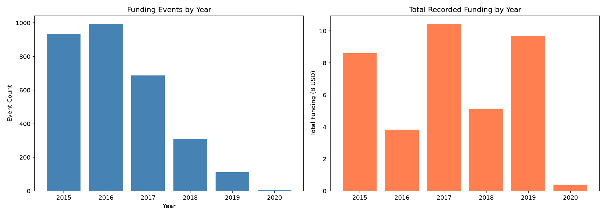

### Top industries and cities

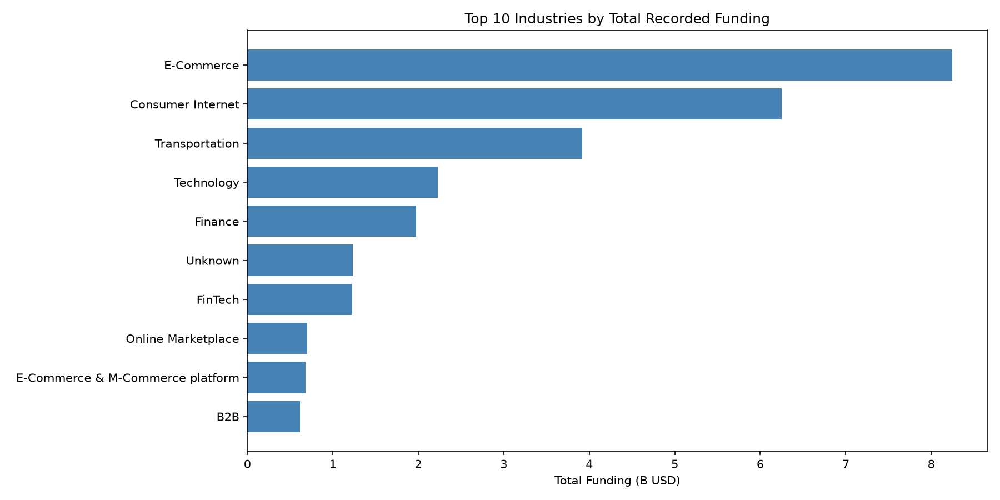

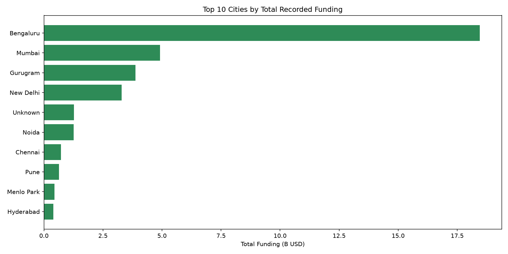

### Funding type distribution

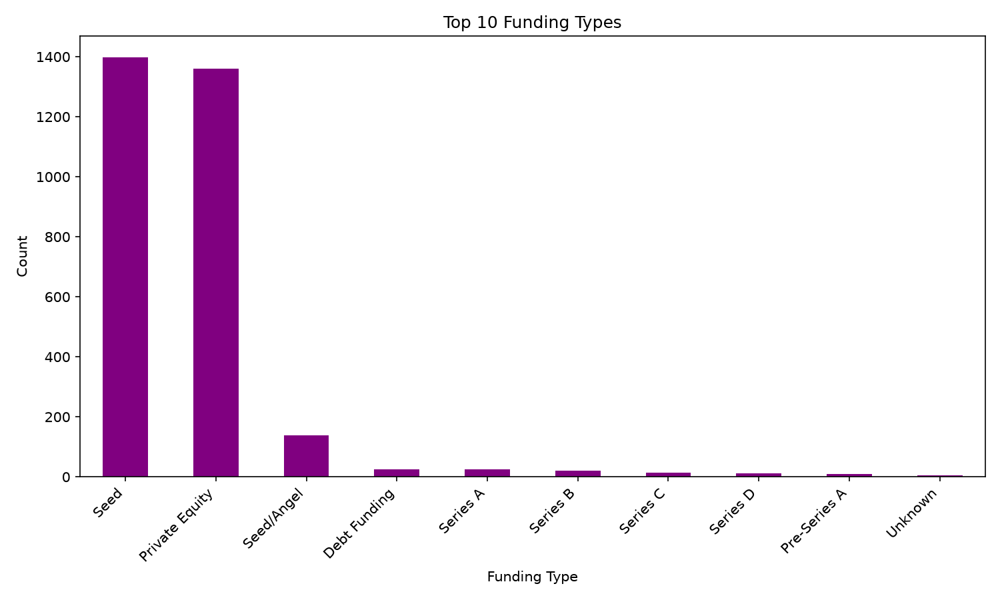

### Top investors by appearance frequency

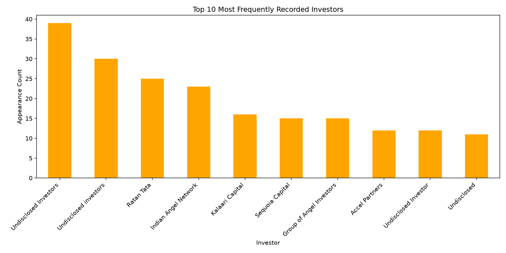

### Funding amount distribution

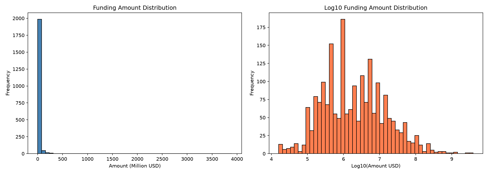

### Model comparison

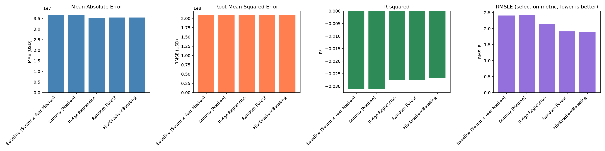

### Explainability

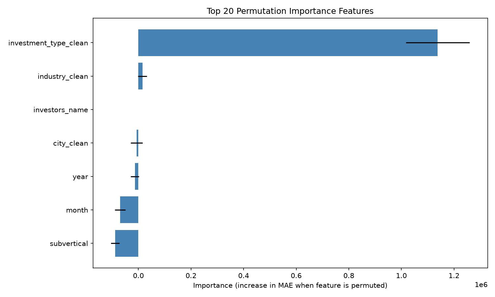

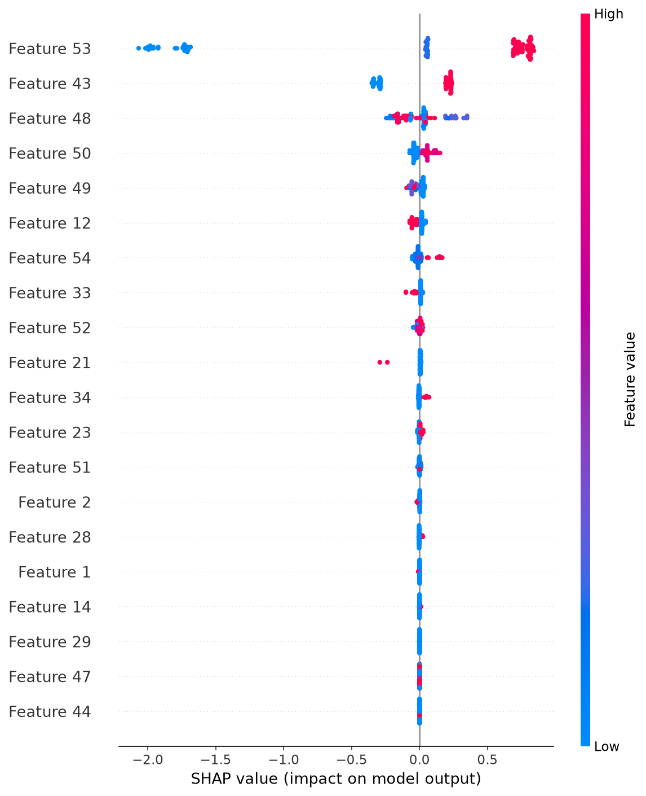

### Clustering

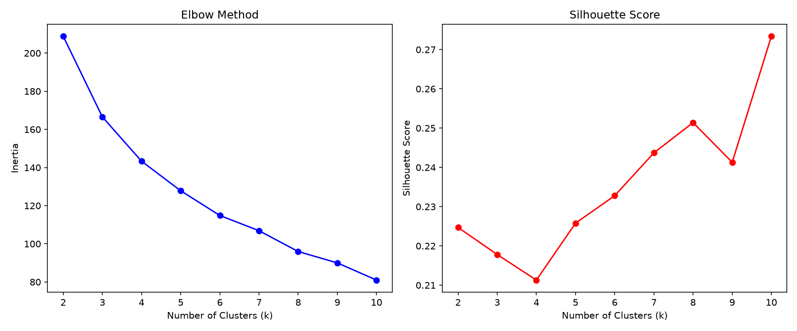

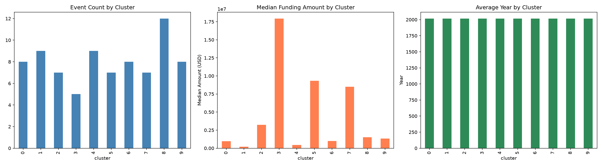

---

## Dashboard Pages

1. **Overview** — Dataset stats, data quality, key findings
2. **Funding Trends** — Time-based analysis with filters
3. **Industry Insights** — Sector rankings and comparisons
4. **City Insights** — Geographic distribution
5. **Investor Insights** — Most frequent investors
6. **Machine Learning** — Model comparison, CV vs test metrics, tuned hyperparameters
7. **Clustering** — K-means profiles, k selection by silhouette, cluster composition
8. **Funding Estimator** — Interactive prediction tool
9. **Explainable AI** — Permutation importance over raw input columns, SHAP over the transformed matrix

Permutation importance shuffles input columns, so it reports the seven raw features only; the `grp_*` median-encoding features are generated downstream and surface in the SHAP plot instead. Because regressors train in `log1p` space, SHAP values describe contributions to **log amount**, not proportional USD.
10. **Methodology** — Data cleaning, assumptions, limitations

---

## Known Limitations

- Historical records from January 2015 – January 2020 do not represent the current startup market
- Missing funding amounts reduce the sample size for modeling
- Investor information excluded from features (not available at prediction time)
- Model predictions are exploratory estimates, not financial advice
- Feature importance does not imply causation
- R² is negative for every model: raw-dollar squared error is dominated by outlier rounds, so RMSLE is the metric to judge these results by
- The dataset contains outliers and inconsistent values that may affect analysis
- `subvertical` is close to unique per row and contributes little beyond noise

---

## Testing

161 tests collected by pytest (129 test functions, expanded by `@parametrize`) covering:
- CSV loading and schema validation
- Date parsing
- Funding amount parsing
- Missing-value handling
- City and category normalization
- Duplicate detection
- Database creation and SQL queries
- Training pipeline execution
- Model serialization and loading
- Prediction input validation
- Prediction output validity
- Target encoding leak safety (unseen and undersized groups fall back correctly)
- Investor name parsing and syndicate feature derivation
- Clustering k sweep, cluster summary and artifact round-trip
- Classification category thresholds derived from training data only
- Shared feature pipeline produces identical columns for both model types
- Hyperparameter grids exclude tied options so selection is reproducible
- Entry points delegate to one pipeline implementation rather than duplicating it
- SHAP applies every pre-regressor step and resolves the fitted inner estimator
- Hyperparameter search wiring and metric correctness
- Every query in `sql/analysis_queries.sql` executes against a built database, and every aggregated column exists
- Every third-party import in the entry points and the suite is declared in `requirements.txt`
- The suite never writes to `models/` or `data/processed/`; a session guard fails the run if it does
- The video renders at both orientations across its whole timeline, with no caption overflowing its panel
- Every local path the README links exists, is not gitignored, and every embedded chart decodes as a real PNG

---

## License

MIT License — see [LICENSE](LICENSE) for details.
